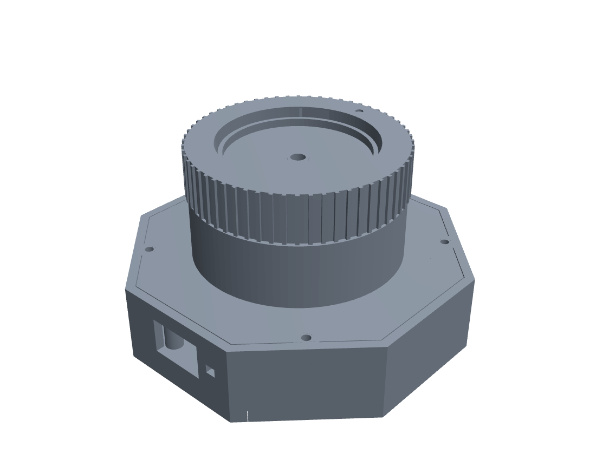

# DMX truss controller

A small DMX512 controller for three fixtures on a room truss (one universe, 21 channels), built around **one Arduino Nano ESP32 and one firmware**.

SmartKnob-style: a **fixed round touch display** with a **ring around it that turns**. The ring is driven by a hollow brushless gimbal motor and gives software detents. Turn the ring to scroll presets, tap the touchscreen to recall one with a fade. Labelling and patching happen on a web page served over Wi-Fi.

**Status: design draft.** Nothing is ordered or printed yet and there is no firmware. See [`docs/open-questions.md`](docs/open-questions.md) for everything that is still unverified.



## Layout

| Folder | What is in it |
|---|---|
| [`bom/`](bom) | Bill of materials: `bom.csv` (source of truth) and generated `BOM.md` with every buy link |
| [`hardware/`](hardware) | [Pinout and wiring](hardware/pinout.md), [screws and hardware](hardware/screws.md), schematic source |
| [`cad/`](cad) | OpenSCAD models, exported STL files, [print notes](cad/README.md) |
| [`docs/`](docs) | Plan v4.5 (PDF + markdown), schematic and concept images, [open questions](docs/open-questions.md) |
| [`scripts/`](scripts) | BOM generator and the clearance check |

## Rules this design follows

- One microcontroller board, one firmware.
- The display never turns; only the ring turns.
- Bare modules, no plastic enclosures. 3D-printed housing in PETG.
- Dutch/EU shops only.
- About 7 cm across. The housing is an octagon 90 mm across flats; the ring is 58 mm.

## Parts at a glance

Arduino Nano ESP32, Waveshare 1.28" round touch display (GC9A01 + CST816S), SparkFun ROB-20441 hollow gimbal motor, TMC6300 driver, MT6701 magnetic angle sensor, MAX485 for DMX, Neutrik XLR panel jack. Full list with links: [`bom/BOM.md`](bom/BOM.md).

## Build the CAD

```sh
cd cad && make            # exports every part to cad/stl/*.stl
make check                # clearance check: turning parts vs fixed parts
```

OpenSCAD is not installed on the host this was made on; the commands above were run with `nix shell nixpkgs#openscad -c make`.

## Plan documents

[`docs/plan-v4.5.pdf`](docs/plan-v4.5.pdf) (same content as [`docs/plan-v4.5.md`](docs/plan-v4.5.md)). Its section 7 housing drawing shows the older slot-and-clamp concept; the CAD in `cad/` is newer.
