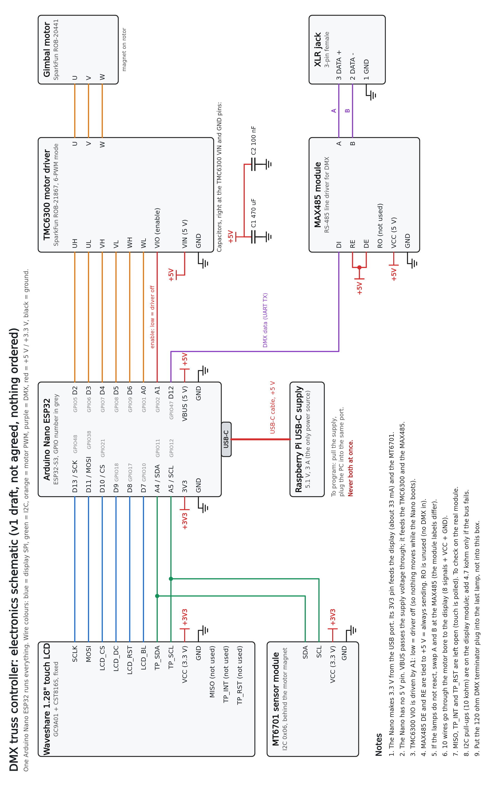
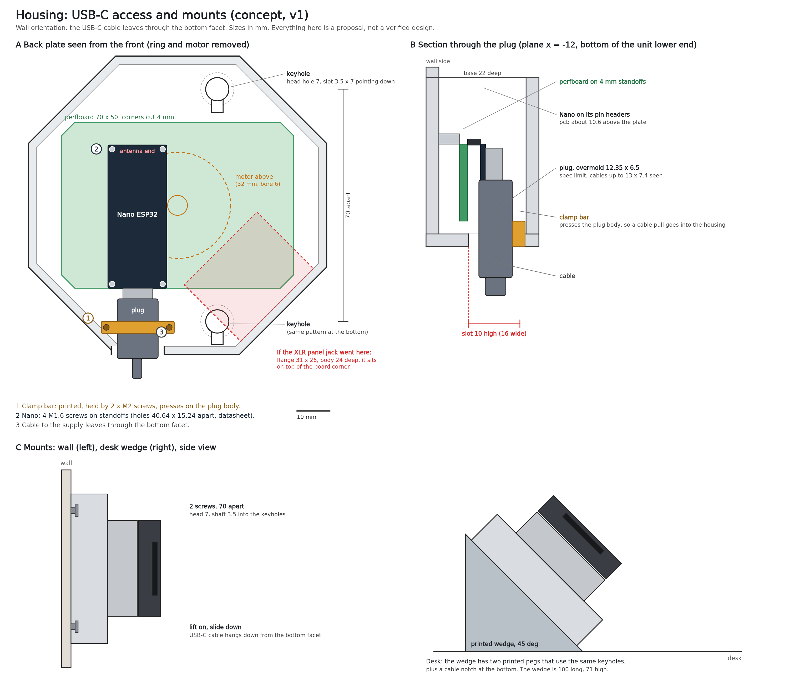

**Status: v4.5 DRAFT. Same as v4.4 with the Conrad link for the Neutrik USB-C jack corrected (v4.4 had a wrong address). BOM agreed (v4.2); Neutrik jack added at your request. The section 7 drawing still shows the older slot-and-clamp idea; the OpenSCAD models in the repo are newer. Not agreed. Nothing ordered.** Schematic, wiring, bill of materials and a first look at the housing for the 1.28 inch design.

# 1. Three corrections to v4.0

I read the Nano ESP32 datasheet and the TMC6300 hardware page before drawing, and that changed three things.

1. **Power path.** In v4.0 I fed 5 V into the Nano's VIN pin through a diode. That is out of spec: the datasheet gives VIN as **6 to 21 V**. New plan: the supply plugs **straight into the Nano's own USB-C port**. The Nano's **VBUS** pin then carries the same 5 V to the TMC6300 and the MAX485. This removes the USB-C breakout, the two 5.1 kohm resistors and the diode from the parts list.
2. **TMC6300 VIO pin.** The driver only works when VIO is powered (1.8 to 5.25 V). I wired it to pin **A1**, so the driver stays off while the Nano boots and the firmware switches it on.
3. **DMX pin.** I moved DMX TX from D1 to **D12**. D1 is the Nano's hardware serial TX and can print text at power-up, which would go out on the DMX cable. This is my reasoning and is not tested.

# 2. Schematic

Full-size PNG sent separately in chat. Blue is display SPI, green is I2C, orange is motor PWM, purple is DMX, red is power.

\newpage

{width=100%}

\newpage

# 3. Wiring, pin by pin

Pin names as printed on the Nano. GPIO numbers checked against the Arduino core file for this board.

**Display module (fixed, 10 wires through the motor bore)**

| Display pin | Nano pin (GPIO) |
|---|---|
| SCLK | D13 (48) |
| MOSI | D11 (38) |
| LCD_CS | D10 (21) |
| LCD_DC | D9 (18) |
| LCD_RST | D8 (17) |
| LCD_BL | D7 (10) |
| TP_SDA | A4 (11) |
| TP_SCL | A5 (12) |
| VCC | 3V3 |
| GND | GND |
| MISO, TP_INT, TP_RST | not connected |

**MT6701 sensor:** SDA to A4, SCL to A5 (same bus as the touch chip), VCC to 3V3, GND to GND.

**TMC6300 driver**

| TMC6300 pin | Connects to |
|---|---|
| UH | D2 (5) |
| UL | D3 (6) |
| VH | D4 (7) |
| VL | D5 (8) |
| WH | D6 (9) |
| WL | A0 (1) |
| VIO | A1 (2) |
| VIN | VBUS pin of the Nano (5 V) |
| GND | GND |
| U, V, W | the three motor wires |

Put C1 (470 uF) and C2 (100 nF) across VIN and GND, right at the driver.

**MAX485 and XLR**

| MAX485 pin | Connects to |
|---|---|
| DI | D12 (47) |
| DE and RE | tied together, to +5 V (always sending) |
| RO | not used |
| VCC | +5 V (VBUS) |
| GND | GND |
| A | XLR pin 3 (DATA +) |
| B | XLR pin 2 (DATA -) |
| XLR pin 1 | GND |

**Power:** the Raspberry Pi supply plugs into the Nano's USB-C port. To program, unplug the supply and plug the PC into the same port. **Never both at once.**

\newpage

# 4. Bill of materials (what to buy)

Prices in EUR incl. VAT. Shipping not included. Stock was read from each shop's own page data on 24 Nov 2026 unless stated.

## Kiwi Electronics (NL), order 1

| Part | Qty | Each | Total | Stock | Link |
|---|---|---|---|---|---|
| Arduino Nano ESP32 with headers | 1 | 21.40 | 21.40 | in stock | [kiwi-electronics.com](https://www.kiwi-electronics.com/en/arduino-nano-esp32-with-headers-11494) |
| SparkFun gimbal motor ROB-20441 | 1 | 53.23 | 53.23 | in stock | [kiwi-electronics.com](https://www.kiwi-electronics.com/en/three-phase-brushless-gimbal-stabilizer-motor-11295) |
| SparkFun TMC6300 driver ROB-21867 | 1 | 20.80 | 20.80 | in stock | [kiwi-electronics.com](https://www.kiwi-electronics.com/en/brushless-motor-driver-3-phase-11460) |
| Capacitor 470 uF 16 V, radial | 1 | 0.96 | 0.96 | in stock | [kiwi-electronics.com](https://www.kiwi-electronics.com/en/470uf-16v-radial-capacitor-20174) |
| 40-pin header strip 2.54 mm | 1 | 0.96 | 0.96 | in stock | [kiwi-electronics.com](https://www.kiwi-electronics.com/en/40-pin-header-strip-2-54mm-pitch-4100) |
| **Kiwi subtotal** | | | **97.35** | | |

## Other shops (one of each; the Conrad row is new)

| Part | Shop | Total | Stock | Link |
|------------------------|--------------------|-------|----------------|------------------|
| Waveshare 1.28 inch Touch LCD module | BerryBase (DE) | 19.90 | limited availability | [berrybase.de](https://www.berrybase.de/en/waveshare-1.28-round-ips-display-module-capacitive-touch-lcd-240-240-ips-spi-and-i2c-io-pins) |
| MT6701 angle sensor module, I2C | Hobby-Electronica (NL) | 3.95 | in stock | [hobbyelectronica.nl](https://www.hobbyelectronica.nl/en/product/mt6701-14-bit-hoeksensor-i2c) |
| MAX485 TTL to RS485 module | Otronic (NL) | 1.15 | in stock | [otronic.nl](https://www.otronic.nl/en/max485-ttl-to-rs485-converter-module) |
| Neutrik NC3 FD-LX XLR panel jack | Thomann (DE) | 4.50 | in stock | [thomann.de](https://www.thomann.de/de/neutrik_nc3_fd_lx.htm) |
| Stairville DMX terminator plug (for the last lamp) | Thomann (DE) | 4.90 | in stock | [thomann.de](https://www.thomann.de/de/stairville_dmx_endstecker_xlr_3pol.htm) |
| **Neutrik NAUSBC-5G-FL10**, D-size USB-C panel jack with 10 cm cable and plug | Conrad (DE) | 11.99 | "available soon" (not in stock, backorder) | [conrad.de](https://www.conrad.de/de/p/neutrik-usb-c-kabel-usb-c-buchse-usb-c-stecker-10-cm-schwarz-flammwidrig-nausbc-5g-fl10-3863079.html) |

## Total

- **Core parts** (Nano, display, motor, TMC6300, MT6701, MAX485, XLR jack, USB-C jack): **EUR 136.92**
- **Plus capacitor and headers:** EUR 138.84
- **Plus terminator plug:** **EUR 143.74**
- **Shipping:** not included. Kiwi, if you ship to NL: letterbox parcel EUR 4.22, parcel EUR 7.20 (free from EUR 150, which this order does not reach). BerryBase, HobbyElectronica, Otronic and Thomann: not checked.

## About the Neutrik USB-C jack

- **Where:** none of the five shops on the list carry it. Kiwi, Thomann and BerryBase have no listing; HobbyElectronica and Otronic I could not search. Conrad is the only shop I found, so the BOM is now six shops.
- **Price:** EUR 11.99 incl. VAT on conrad.de, EUR 12.99 on conrad.com. The FL15 and FL25 versions are listed at Conrad too, but I did not read their price.
- **Stock:** Conrad says "Bald verfuegbar" with "order now, receive later", so it is not in stock today. Conrad blocks my page reads, so this is from a search snippet.
- **Length:** the 10 cm lead is enough if the Nano sits next to the jack; FL15 gives more slack.
- **Replaces** the slot and clamp bar in section 7.1 and the supply plug going into the Nano directly.

## Not bought, on purpose

- **USB-C supply:** you already own one (5 V, 3 A).
- **30 AWG wire:** the display ships with a 13-pin cable that may do the job. Check it first.
- **100 nF capacitors (optional):** only a 450-piece kit at Kiwi. Add two if HobbyElectronica or Otronic sell them; I have not checked.
- **Perfboard, screws, PETG, DMX cable:** you have these.

# 5. Not verified yet

1. **VBUS current.** The Nano datasheet gives no current rating for the VBUS pin. The motor at stall on 5 V draws about 0.55 A (5 V divided by about 9 ohm, my arithmetic), so it should be fine. Alternative: a separate 5 V breakout.
2. **Motor at 5 V.** The SparkFun motor is rated 6 to 8 V, so on 5 V it has less torque. The TMC6300 itself accepts 2 to 11 V.
3. **MT6701 module pins.** The listing says I2C; I have not seen the pin names.
4. **Display cable.** Waveshare lists a 13-pin GH1.25 cable in the box. I have not seen what BerryBase ships, or whether the far end is bare or a plug.
5. **Both chips on one I2C bus.** The CST816S answers at 0x15 and the MT6701 at 0x06 per their documents. Not tested.
6. **MAX485 module.** Some have a 120 ohm resistor built in. The Otronic listing does not say. A and B labels differ between makers, so swapping them may be needed.
7. **DMX termination.** The terminator belongs in the last lamp, not in this box. Some lamps may have a built-in switch; not checked.
8. **Motor poles.** The SparkFun datasheet says 8 magnetic poles, SmartKnob's firmware assumes 14. Check before firmware.
9. **DMX on D12.** Moved from D1 because D1 is the hardware UART TX. That is my reasoning and is not tested.

# 6. Open questions

1. **Is the bill of materials OK to order?** Five shops.
2. **Housing:** the supply's USB-C plug goes into the Nano, so the housing needs a slot for it. OK?

\newpage

# 7. Housing: USB-C access and mounts (concept)

**Update:** you chose a D-size USB-C jack that matches the XLR jack. The drawing and 7.1 below still show the older slot-and-clamp idea and will be redrawn. With two D-size jacks (XLR on top, USB-C at the bottom) the base grows to about 28 to 30 mm deep and the board to about 60 x 45 mm.

All sizes in mm. Facts are from datasheets and drawings; everything else is my proposal and is marked as such.

{width=100%}

\newpage

## 7.1 USB-C and the Nano

**Facts**

- **Nano size:** 43.18 x 17.78 mm, four mounting holes of 1.66 mm diameter, spaced 40.64 x 15.24 mm (Arduino datasheet, mechanical page). So it takes four M1.6 screws.
- **USB-C plug body:** the USB spec allows up to 12.35 x 6.5 mm. One engineer who measured real cables saw up to 13.0 x 7.4 and designed for 16 x 10 (electronics.stackexchange answer). I have not measured your supply's plug.
- **Your supply:** the Raspberry Pi supply has a fixed 1.5 m cable (18 AWG) per Raspberry Pi's product brief.

**Proposal**

- **Slot:** 16 wide x 10 high in the bottom facet, so any normal plug fits and the same port still takes a PC cable for flashing.
- **Nano:** four M1.6 screws on 3 to 4 mm standoffs, so a pulled cable cannot bend the board. The first flash needs the cable, and the clamp bar comes off with two screws.
- **Clamp bar:** a printed bridge, held by two M2 screws, presses on the plug body. A pull on the cable then goes into the housing, not into the USB-C solder joints. The fixed cable has no strain relief of its own at the Nano.
- **Cable exit:** the bottom facet, so it hangs down on a wall.

## 7.2 Mounts

- **Wall:** two keyhole slots in the back plate, 70 apart (head hole 7, slot 3.5 x 7 pointing down). You put two screws in the wall, lift the unit on and slide it down. The screw spacing and sizes are my proposal.
- **Desk:** a printed wedge at 45 degrees (100 long, 71 high) with two printed pegs that use the same keyholes, and a cable notch at the bottom.
- **Perfboard:** 70 x 50 only just fits inside the octagon (0.1 mm to spare when centred). Cut the four corners by 4 mm.

## 7.3 Problem: the XLR panel jack

I took the dimensions from Neutrik's own drawing of the NC3FD-LX: flange 26 x 31, panel hole 23.6 plus two 3.1 mm screw holes, and **24.1 behind the panel** (32.7 overall).

- **Depth:** the flange is 26 wide, so the base would need to be about 31 deep instead of 22.
- **Space:** the 24 mm body then sits on top of the perfboard area. In the drawing the red dashed box is the jack on the lower right facet, and it lands on the board corner.

**Two ways out**

- **A. Short tail (my recommendation):** drop the panel jack. A 10 to 15 cm three-core cable leaves through a small slot, ending in a female XLR cable connector (Neutrik NC3FXX, about EUR 4 per a Thomann search snippet that I did not check on the page). The base stays 22 deep and the board stays as drawn. The BOM changes by about EUR 0 to 1 plus a bit of cable.
- **B. Keep the panel jack:** base about 32 deep (ring sticks out 10 mm further from the wall) and a smaller board, about 55 x 45, moved away from the jack.

## 7.4 Not verified

1. **Nano antenna** points toward the middle, near the motor. The motor is about 10 mm above the board. Wi-Fi range is not tested.
2. **Nano height** (about 10.6 above the plate on its headers) is my estimate. It decides the slot height.
3. **Real plug size** of your supply. Measure it before printing.
4. **Board fit.** Parts on the board (TMC6300, MAX485 module) are not laid out yet.

## 7.5 Questions

1. **XLR:** A (short tail, recommended) or B (panel jack, deeper box)?
2. **Wall:** two screws and keyholes OK?
3. **Desk:** printed 45 degree wedge OK?
